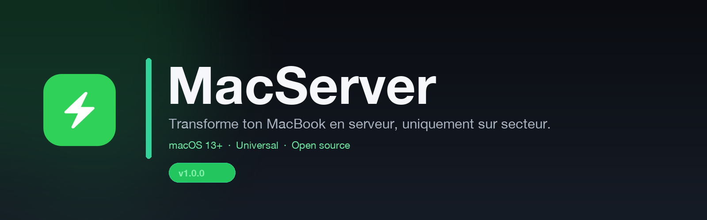

<p align="center">
  
</p>

<p align="center">
  <a href="https://github.com/Am1ne12/MacServer/releases/latest"></a>
  
  
  
</p>

<h1 align="center">MacServer</h1>

<p align="center">
  Transforme ton MacBook en serveur quand il est branché.<br>
  Sur batterie, il redevient un portable normal.
</p>

<p align="center">
  <a href="#installation"><strong>Installer</strong></a> ·
  <a href="#utilisation">Utilisation</a> ·
  <a href="#comment-ça-marche">Fonctionnement</a> ·
  <a href="#dépannage">Dépannage</a>
</p>

---

## Pourquoi MacServer ?

Un MacBook est un excellent petit serveur : il est silencieux, économe et assez puissant pour faire tourner un serveur de développement, un agent, un serveur de fichiers ou des téléchargements.

Mais macOS n'a pas de mode « serveur uniquement sur secteur » :

- `caffeinate` ne bloque pas la veille quand le capot est fermé de façon fiable ;
- `pmset -a disablesleep 1` fonctionne, mais reste actif même sur batterie ;
- il n'existe pas de réglage natif pour « reste éveillé sur secteur, dors normalement sur batterie ».

MacServer comble ce manque avec un petit service macOS et une icône dans la barre des menus.

## Fonctionnalités

- **Mode serveur automatique sur secteur** : la veille système est désactivée, même capot fermé. L'écran peut s'éteindre, le réseau reste actif.
- **Comportement normal sur batterie** : MacServer remet la veille macOS normale et endort le Mac si le capot est fermé.
- **Réveil au branchement** : `acwake` demande à macOS de se réveiller quand le chargeur est connecté ; le service le maintient ensuite éveillé.
- **Mode serveur sur batterie optionnel** : le Mac reste éveillé jusqu'à 20 %, puis s'endort pour préserver la batterie.
- **Verrouillage de l'écran** : à la fermeture du capot, l'écran s'éteint et la session se verrouille. Le serveur continue de tourner.
- **Icône toujours visible** : serveur secteur, portable/pause, serveur batterie, alerte.
- **Menu complet** : pause/reprise, mode batterie, verrouillage immédiat, journal, désinstallation.
- **CLI `macserver`** : `status`, `pause`, `resume`, `battery on|off`.
- **Service root au boot** : LaunchDaemon avec redémarrage automatique.
- **Aucune dépendance externe** : Swift/AppKit pour l'icône, zsh et `pmset` pour le service.
- **Binaire universel** : Apple Silicon et Intel.
- **Désinstallation propre** : restaure la veille macOS et supprime tous les fichiers.

## Aperçu

<p align="center">
  
</p>

<p align="center">
  
</p>

<p align="center">
  <em>Aperçu de l'interface. Les visuels sont générés à partir des icônes réelles de l'app.</em>
</p>

## Installation

### Téléchargement (recommandé)

1. Télécharge le DMG depuis **[Releases](https://github.com/Am1ne12/MacServer/releases/latest)**.
2. Ouvre le DMG.
3. Double-clique sur **`Install MacServer.command`**.
4. Entre ton mot de passe administrateur.
5. Autorise MacServer dans **Réglages Système > Général > Ouverture de session et extensions** si macOS le demande.
6. L'icône MacServer apparaît dans la barre des menus.

> **Gatekeeper** : l'application et l'installeur ne sont pas notariés (pas de compte Apple Developer). Si macOS bloque l'ouverture, fais un **clic droit > Ouvrir** sur `Install MacServer.command`. Tu peux aussi passer par **Réglages Système > Confidentialité et sécurité > Ouvrir quand même**.

L'installation installe :

- `/Applications/MacServer.app`
- `/usr/local/bin/macserver`
- `/usr/local/libexec/macserver-uninstall`
- `/Library/LaunchDaemons/com.am1ne.macserver.daemon.plist`
- `~/Library/LaunchAgents/com.am1ne.macserver.app.plist`
- `/Users/Shared/MacServer/` (état et drapeaux)
- `/var/log/macserver.log`

### Depuis les sources

Prérequis : macOS 13 ou plus récent, Xcode Command Line Tools (`xcode-select --install`).

```bash
git clone https://github.com/Am1ne12/MacServer.git
cd MacServer
./build.sh
sudo ./install.sh
```

Pour construire un DMG :

```bash
./scripts/release.sh 1.0.0
```

Le DMG est créé dans `dist/`.

## Utilisation

### Les icônes

| Icône | État | Comportement |
|---|---|---|
| Carré **vert** + éclair | Serveur sur secteur | Veille désactivée, capot ouvert ou fermé |
| Carré **orange** + pause | Portable normal / en pause | Veille macOS normale |
| Carré **orange** + éclair | Serveur sur batterie | Éveillé jusqu'à 20 %, puis veille |
| Carré **rouge** + `!` | Alerte | Service arrêté ou état incohérent |

L'icône MacServer est toujours visible. Si elle n'apparaît pas, ta barre des menus est probablement pleine : masque quelques icônes ou utilise un gestionnaire de barre de menus.

### Le menu

- **Mettre en pause / Reprendre** : revient temporairement au comportement normal. Le menu pause n'apparaît que lorsque le Mac est en mode serveur.
- **Rester éveillé sur batterie (max 20 %)** : mode serveur sur batterie, désactivé par défaut. Le Mac reste éveillé jusqu'à 20 %, puis s'endort.
- **Verrouiller l'écran maintenant** : éteint l'écran et verrouille la session immédiatement. Le service continue de tourner.
- **Ouvrir le journal** : ouvre `/var/log/macserver.log`.
- **Désinstaller MacServer…** : arrête le service, restaure la veille normale et supprime l'application.
- **Quitter l'icône** : ferme seulement l'icône ; le service continue de tourner.

### Ligne de commande

```bash
macserver status                 # état complet
macserver pause                  # mettre le serveur en pause
macserver resume                 # reprendre
macserver battery on             # serveur sur batterie jusqu'à 20 %
macserver battery off            # désactiver le mode batterie
```

Diagnostic :

```bash
pmset -g | grep SleepDisabled    # 1 = veille désactivée
pmset -g ps                      # source d'alimentation
tail -f /var/log/macserver.log   # journal du service
```

## Comment ça marche

MacServer est composé de deux parties :

1. **`MacServer.app`** : une petite app AppKit dans la barre des menus. Elle lit un fichier d'état et affiche l'icône correspondante.
2. **`com.am1ne.macserver.daemon`** : un LaunchDaemon root qui applique la politique de veille.

Le service vérifie l'état environ une fois par seconde :

- **Sur secteur** → `pmset -a disablesleep 1`. C'est le seul réglage macOS fiable pour empêcher la veille quand le capot est fermé.
- **Sur batterie** → `pmset -a disablesleep 0`. Si le capot est fermé, `pmset sleepnow` endort immédiatement le Mac.
- **Mode batterie** → `disablesleep 1` jusqu'à 20 %, puis retour à la veille normale.
- **Au branchement** → `acwake` réveille le Mac, puis le service applique `disablesleep 1` et maintient brièvement une assertion `caffeinate -s` pour éviter une re-veille immédiate.
- **À la fermeture du capot** → `pmset displaysleepnow` éteint l'écran pour déclencher le verrouillage macOS.
- **À l'arrêt ou à la désinstallation** → `disablesleep 0` est restauré.

L'app et le service communiquent par un petit fichier d'état dans `/Users/Shared/MacServer/status`. Aucune connexion réseau, aucun démon externe.

## Mode serveur sur batterie

Par défaut, MacServer ne modifie rien sur batterie : le Mac s'endort normalement.

Si tu veux qu'il continue à servir après débranchement, active **« Rester éveillé sur batterie (max 20 %) »** dans le menu. Tu peux aussi le faire en Terminal :

```bash
macserver battery on
```

Le Mac reste éveillé jusqu'à 20 %, puis s'endort pour ne pas vider la batterie. Ce mode consomme de la batterie et produit de la chaleur : garde le Mac sur une surface ventilée et ne le mets pas dans une housse.

## Verrouillage et sécurité

Quand le capot se ferme, le service éteint l'écran. macOS verrouille alors la session si ce réglage est actif :

**Réglages Système > Écran verrouillé > Exiger un mot de passe après le début de l'économiseur d'écran ou la désactivation de l'écran > Immédiatement.**

Le serveur continue de tourner pendant que l'écran est verrouillé. Quand tu ouvres le capot, macOS demande ton mot de passe ; les services réseau restent accessibles.

**FileVault** est indépendant de MacServer. S'il est activé, un redémarrage demandera ton mot de passe avant que le service puisse repartir. Pour un serveur vraiment headless, il faut soit désactiver FileVault, soit accepter un déverrouillage manuel après chaque redémarrage.

Le service tourne en root, mais n'exécute que des commandes système fixes et ne lit que des drapeaux locaux. Il n'ouvre aucun port et ne fait aucun appel réseau.

> L'app est signée ad hoc, pas notariée. C'est suffisant pour un usage personnel, mais macOS peut afficher un avertissement Gatekeeper au premier lancement.

## Points importants

- **Chaleur** : ne jamais laisser un MacBook éveillé, capot fermé, dans une housse, un sac ou sur un lit. Pose-le sur une surface dure et ventilée.
- **`disablesleep` n'est pas documenté par Apple** et peut changer avec une future version de macOS. Le service vérifie son état et écrit une erreur dans le journal si la commande échoue.
- **`acwake` dépend du matériel**. Sur certains Mac Apple Silicon, le réveil au branchement peut ne pas fonctionner. Le mode serveur sur batterie reste disponible comme solution de secours.
- **Conflit** : si une autre application (Amphetamine, KeepingYouAwake, etc.) modifie `SleepDisabled`, les deux outils peuvent se battre. Quitte les autres outils de veille.
- **Barre des menus pleine** : macOS peut cacher l'icône si la barre est saturée. Masque quelques icônes ou utilise un gestionnaire de barre de menus.
- **Redémarrage après coupure** : pour que le Mac redémarre automatiquement après une coupure de courant :
  ```bash
  sudo pmset -c autorestart 1
  ```

## Dépannage

### L'icône n'apparaît pas

La barre des menus est peut-être pleine. Vérifie que l'app tourne :

```bash
pgrep -fl MacServer
macserver status
```

Si le service répond mais que l'icône est absente, masque quelques icônes de la barre des menus ou utilise un gestionnaire comme Ice.

### `SleepDisabled` reste à 0 sur secteur

```bash
macserver status
tail -20 /var/log/macserver.log
pmset -g | grep SleepDisabled
```

Vérifie que le service est chargé :

```bash
launchctl print system/com.am1ne.macserver.daemon
```

### Le Mac s'endort quand même capot fermé

```bash
pmset -g | grep SleepDisabled
pmset -g log | grep -E "Clamshell|Sleep" | tail -20
```

`SleepDisabled` doit être à `1` sur secteur. Si ce n'est pas le cas, réinstalle l'app ou consulte le journal.

### Le réveil au branchement ne marche pas

`acwake` n'est pas supporté de façon fiable sur tous les Mac. Active le mode serveur sur batterie si tu as besoin que le Mac reste disponible après débranchement.

### Réinstaller

Télécharge le DMG depuis [Releases](https://github.com/Am1ne12/MacServer/releases/latest), ou depuis les sources :

```bash
./build.sh
sudo ./install.sh
```

## Désinstallation

Depuis l'icône : **Désinstaller MacServer…**

Ou en Terminal :

```bash
sudo /usr/local/libexec/macserver-uninstall
```

La désinstallation :

- arrête le service et l'icône ;
- remet `disablesleep 0` et `acwake 0` ;
- supprime le LaunchDaemon, le LaunchAgent, l'app, la CLI, l'état et le journal.

## Structure du projet

```text
MacServer/
├── app/
│   ├── main.swift
│   ├── Info.plist
│   ├── AppIcon.icns
│   └── com.am1ne.macserver.app.plist
├── daemon/
│   ├── macserver
│   ├── macserver-uninstall
│   └── com.am1ne.macserver.daemon.plist
├── docs/
│   └── images/
├── scripts/
│   ├── install-from-dmg.sh
│   ├── make-app-icon.swift
│   ├── make-doc-icons.swift
│   ├── make-doc-images.py
│   └── release.sh
├── build.sh
├── install.sh
├── uninstall.sh
├── Installer.command
├── README.md
├── CHANGELOG.md
└── LICENSE
```

## Contribuer

Les issues et pull requests sont les bienvenues.

- Teste sur macOS 13 ou plus récent.
- Lance `./build.sh` avant de proposer une modification.
- Garde le service petit et sans dépendance externe.
- Pour les changements de comportement, explique le cas d'usage dans la PR.

## Licence

MIT — voir [LICENSE](LICENSE).

MacServer n'est pas affilié à Apple. Utilise-le à tes propres risques.

---

## English summary

MacServer is a small macOS menu bar app and LaunchDaemon that keeps your MacBook awake as a server **only while it is plugged in**. On battery, it restores normal macOS sleep behavior. It also supports an optional battery server mode (until 20%), automatic screen locking when the lid closes, and wake-on-charger via `acwake`.

Built with Swift/AppKit and a small zsh daemon using `pmset`. Universal binary for Apple Silicon and Intel, macOS 13+.

Download the latest DMG from [Releases](https://github.com/Am1ne12/MacServer/releases/latest).

---

<p align="center">
  Fait avec Swift, AppKit et <code>pmset</code>.
</p>
