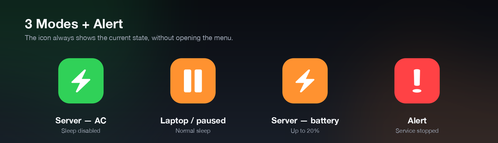
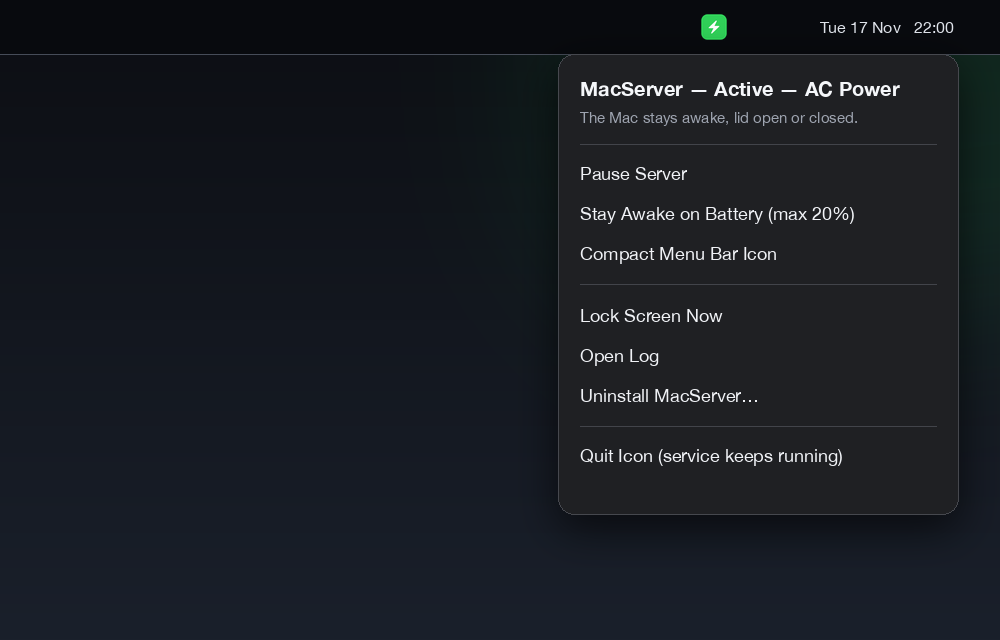

<p align="center">
  
</p>

<p align="center">
  <a href="https://github.com/Am1ne12/MacServer/releases/latest"></a>
  
  
  
</p>

<h1 align="center">MacServer</h1>

<p align="center">
  Turn your MacBook into a server while it is plugged in.<br>
  On battery, it goes back to being a normal laptop.
</p>

<p align="center">
  <a href="https://github.com/Am1ne12/MacServer/releases/download/v1.1.0/MacServer-1.1.0.dmg">
    
  </a>
  <a href="https://github.com/Am1ne12/MacServer/releases/latest">
    
  </a>
</p>

<p align="center">
  <sub>macOS blocked the download? <a href="#macos-blocked-the-app"><strong>See the Gatekeeper workaround</strong></a>.</sub>
</p>

<p align="center">
  <a href="#installation"><strong>Install</strong></a> ·
  <a href="#macos-blocked-the-app">Gatekeeper</a> ·
  <a href="#usage">Usage</a> ·
  <a href="#how-it-works">How it works</a> ·
  <a href="#troubleshooting">Troubleshooting</a>
</p>

---

## Why MacServer?

A MacBook makes a great small server: it is quiet, power-efficient and powerful enough for a development server, an agent, a file server or downloads.

But macOS has no built-in "server only on AC power" mode:

- `caffeinate` does not reliably prevent sleep when the lid is closed;
- `pmset -a disablesleep 1` works, but it also applies on battery;
- there is no native setting for "stay awake on AC power, sleep normally on battery".

MacServer fills that gap with a small macOS service and a menu bar icon.

## Features

- **Automatic server mode on AC power**: system sleep is disabled, even with the lid closed. The display can turn off while the network stays active.
- **Normal battery behavior**: MacServer restores normal macOS sleep and puts the Mac to sleep when the lid is closed.
- **Wake on charger connection**: `acwake` asks macOS to wake when the charger is connected; the service then keeps it awake.
- **Optional battery server mode**: the Mac stays awake on battery until 20%, then goes to sleep to protect the battery.
- **Battery guard**: in battery server mode, Low Power Mode turns on below 40% and the session ends at 20%.
- **Thermal protection**: if macOS reports critical thermal pressure, sleep is re-enabled automatically (best effort).
- **Screen lock**: closing the lid turns off the display and locks the session. The server keeps running.
- **Always-visible icon**: server on AC, laptop/paused, server on battery, thermal alert.
- **Compact menu bar icon**: a smaller icon for crowded menu bars.
- **Full menu**: pause/resume, battery mode, compact icon, lock screen now, log, uninstall.
- **`macserver` CLI**: `status`, `pause`, `resume`, `battery on|off`, `compact on|off`.
- **Root LaunchDaemon**: starts at boot and restarts automatically if it exits.
- **Recovery watchdog**: a second LaunchDaemon checks every 30 seconds and restores normal sleep if the main service dies or becomes stale.
- **Install skill**: a `skills/install-macserver` file lets a coding agent download, verify, and install the app from Terminal.
- **Release checksums**: each release includes `SHA256SUMS`.
- **No external dependencies**: Swift/AppKit for the icon, zsh and `pmset` for the service.
- **Universal binary**: Apple Silicon and Intel.
- **Clean uninstall**: restores normal macOS sleep, Low Power Mode, and removes every file.

## Preview

<p align="center">
  
</p>

<p align="center">
  
</p>

<p align="center">
  <em>Interface preview. The visuals are generated from the app's real icon states.</em>
</p>

## Installation

### Install with your coding agent

Paste this into your coding agent:

```text
Install MacServer from https://github.com/Am1ne12/MacServer by following skills/install-macserver/SKILL.md. If a step needs my password, give me the command to run in Terminal.
```

The agent downloads the latest release, verifies the SHA-256 checksum, and installs from Terminal. This avoids the double-click Gatekeeper issue.

### Download the DMG

<p align="center">
  <a href="https://github.com/Am1ne12/MacServer/releases/download/v1.1.0/MacServer-1.1.0.dmg">
    
  </a>
</p>

1. Download the DMG above.
2. Open the DMG.
3. Double-click **`Install MacServer.command`**.
4. Enter your administrator password.
5. Allow MacServer in **System Settings > General > Login Items & Extensions** if macOS asks.
6. The MacServer icon appears in the menu bar.

> **macOS blocked the app?** This is expected for an unsigned app. See [macOS blocked the app](#macos-blocked-the-app) for the full workaround.

Download the DMG and `SHA256SUMS` from the release, then verify the DMG before opening it:

```bash
cd ~/Downloads
shasum -a 256 -c SHA256SUMS
```

The installer adds:

- `/Applications/MacServer.app`
- `/usr/local/bin/macserver`
- `/usr/local/libexec/macserver-uninstall`
- `/Library/LaunchDaemons/com.am1ne.macserver.daemon.plist`
- `/Library/LaunchDaemons/com.am1ne.macserver.watchdog.plist`
- `~/Library/LaunchAgents/com.am1ne.macserver.app.plist`
- `/Users/Shared/MacServer/` (state and flags)
- `/var/log/macserver.log`

### Build from source

Requirements: macOS 13 or later, Xcode Command Line Tools (`xcode-select --install`).

```bash
git clone https://github.com/Am1ne12/MacServer.git
cd MacServer
./build.sh
sudo ./install.sh
```

Build a DMG:

```bash
./scripts/release.sh 1.1.0
```

The DMG is created in `dist/`.

## macOS blocked the app?

MacServer is ad-hoc signed and not notarized. macOS Gatekeeper blocks downloaded unsigned apps. This is expected and does not mean the app is malicious.

You may need to approve **both** the installer and the app.

### Use System Settings (Open Anyway)

1. Double-click `Install MacServer.command` (or `MacServer.app`) once.
2. When macOS says it cannot verify the app, click **Done**.
3. Open **System Settings > Privacy & Security**.
4. Scroll down to **Security**.
5. Click **Open Anyway** next to the MacServer message.
6. Enter your administrator password, then click **Open**.
7. If macOS asks again for the other item, repeat these steps.

If **Open Anyway** does not appear, try to open the blocked item again, then check **Privacy & Security** right away.

### Remove the quarantine from the downloaded DMG

```bash
xattr -dr com.apple.quarantine ~/Downloads/MacServer-1.1.0.dmg
open ~/Downloads/MacServer-1.1.0.dmg
```

Then double-click `Install MacServer.command`.

### Download with curl (no quarantine)

```bash
curl -L -o ~/Downloads/MacServer-1.1.0.dmg \
  https://github.com/Am1ne12/MacServer/releases/download/v1.1.0/MacServer-1.1.0.dmg
open ~/Downloads/MacServer-1.1.0.dmg
```

Files downloaded from Terminal do not get the `com.apple.quarantine` attribute.

### Install directly from Terminal

This bypasses the blocked `Install MacServer.command`:

```bash
cd "/Volumes/MacServer 1.1.0"
sudo .installer/install.sh
```

The installer removes the quarantine from `/Applications/MacServer.app`.

### Build from source

A locally built app is not quarantined:

```bash
git clone https://github.com/Am1ne12/MacServer.git
cd MacServer
./build.sh
sudo ./install.sh
```

> **Do not disable Gatekeeper globally** with `sudo spctl --master-disable`. It lowers the security of your whole Mac.

## Usage

### Icon states

| Icon | State | Behavior |
|---|---|---|
| **Green** square + bolt | Server on AC power | Sleep disabled, lid open or closed |
| **Orange** square + pause | Laptop / paused | Normal macOS sleep |
| **Orange** square + bolt | Server on battery | Awake until 20%, then sleep |
| **Red** square + `!` | Alert | Service stopped, thermal protection, or inconsistent state |

The MacServer icon is always visible. If it does not appear, your menu bar is probably full: run `macserver compact on` or hide a few icons.

### Menu

- **Pause Server / Resume Server**: temporarily restore normal behavior. The pause item only appears while the Mac is in server mode.
- **Stay Awake on Battery (max 20%)**: battery server mode, off by default. The Mac stays awake until 20%, then sleeps.
- **Compact Menu Bar Icon**: switches to a smaller 16×16 icon for crowded menu bars.
- **Lock Screen Now**: turns off the display and locks the session immediately. The service keeps running.
- **Open Log**: opens `/var/log/macserver.log`.
- **Uninstall MacServer…**: stops the service, restores normal sleep and removes the app.
- **Quit Icon**: closes only the icon; the service keeps running.

### Command line

```bash
macserver status                 # full status
macserver pause                  # pause the server
macserver resume                 # resume
macserver battery on             # server on battery until 20%
macserver battery off            # disable battery mode
macserver compact on             # smaller menu bar icon
macserver compact off            # normal menu bar icon
```

Diagnostics:

```bash
pmset -g | grep SleepDisabled    # 1 = sleep disabled
pmset -g ps                      # power source
tail -f /var/log/macserver.log   # service log
```

## How it works

MacServer has three parts:

1. **`MacServer.app`**: a small AppKit menu bar app. It reads a state file and displays the matching icon.
2. **`com.am1ne.macserver.daemon`**: a root LaunchDaemon that applies the sleep policy.
3. **`com.am1ne.macserver.watchdog`**: a second root LaunchDaemon that checks the main service every 30 seconds.

The main service checks the state about once per second:

- **On AC power** → `pmset -a disablesleep 1`. This is the only reliable macOS setting that prevents sleep with the lid closed.
- **On battery** → `pmset -a disablesleep 0`. If the lid is closed, `pmset sleepnow` puts the Mac to sleep immediately.
- **Battery mode** → `disablesleep 1` until 20%, then normal sleep.
- **Battery guard** → below 40%, Low Power Mode is enabled for the battery profile; it is restored when no longer needed.
- **Thermal protection** → if macOS reports critical thermal pressure, `disablesleep 0` is restored and the Mac can sleep. This is best effort because Apple Silicon may not expose thermal telemetry.
- **On charger connection** → `acwake` wakes the Mac, then the service applies `disablesleep 1` and briefly holds a `caffeinate -s` assertion to avoid going back to sleep immediately.
- **On lid close** → `pmset displaysleepnow` turns off the display to trigger macOS screen locking.
- **On stop or uninstall** → `disablesleep 0` and the original Low Power Mode state are restored.

The watchdog runs every 30 seconds. If the main daemon is not running, or its status file is older than 60 seconds, the watchdog restores normal sleep, releases any Low Power Mode it owns, and asks launchd to restart the main service. The app and the service communicate through a small state file in `/Users/Shared/MacServer/status`. No network connection, no external daemon.

## Battery server mode

By default, MacServer does nothing on battery: the Mac sleeps normally.

If you want it to keep serving after unplugging, enable **"Stay Awake on Battery (max 20%)"** in the menu. You can also use the CLI:

```bash
macserver battery on
```

The Mac stays awake until 20%, then sleeps to avoid draining the battery. Below 40%, MacServer enables Low Power Mode for the battery profile; it restores it when you plug in, disable battery mode, or the session ends. This mode uses battery power and produces heat: keep the Mac on a ventilated surface and never put it in a bag.

## Screen lock and security

When the lid closes, the service turns off the display. macOS then locks the session if this setting is enabled:

**System Settings > Lock Screen > Require password after screen saver begins or display is turned off > Immediately.**

The server keeps running while the screen is locked. When you open the lid, macOS asks for your password; network services remain reachable.

**FileVault** is independent of MacServer. If it is enabled, a reboot will require your password before the service can start again. For a truly headless server, either disable FileVault or accept a manual unlock after each reboot.

The service runs as root, but it only executes fixed system commands and reads local flags. It opens no ports and makes no network calls.

> The app is ad-hoc signed, not notarized. macOS may show a Gatekeeper warning on first launch; see [macOS blocked the app](#macos-blocked-the-app) if needed.

## Important notes

- **Heat**: never leave a MacBook awake with the lid closed in a bag, sleeve or on a bed. Keep it on a hard, ventilated surface.
- **`disablesleep` is not documented by Apple** and may change in a future macOS release. The service checks its state and writes an error to the log if the command fails.
- **`acwake` depends on the hardware**. On some Apple Silicon Macs, wake-on-charger may not work. Battery server mode remains available as a fallback.
- **Conflicts**: if another app (Amphetamine, KeepingYouAwake, etc.) changes `SleepDisabled`, the two tools may fight. Quit other keep-awake apps.
- **Full menu bar**: macOS may hide the icon if the menu bar is crowded. Run `macserver compact on` for the smaller icon, hide a few icons, or use a menu bar manager.
- **Thermal telemetry**: the thermal rule only works when macOS reports `CPU_Speed_Limit` or `Scheduler_Limit`; on some Apple Silicon Macs those values are not exposed, so the rule is best effort.
- **Low Power Mode**: MacServer only changes the battery Low Power Mode while battery server mode is active and restores it when no longer needed.
- **Watchdog**: if the main service is killed, the watchdog restores normal sleep and restarts it within about 30–60 seconds.
- **Restart after power loss**: to make the Mac restart automatically after a power failure:
  ```bash
  sudo pmset -c autorestart 1
  ```

## Troubleshooting

### The icon does not appear

Your menu bar may be full. Check that the app is running:

```bash
pgrep -fl MacServer
macserver status
```

If the service responds but the icon is missing, switch to the compact icon or hide a few menu bar icons:

```bash
macserver compact on
```

### `SleepDisabled` stays at 0 on AC power

```bash
macserver status
tail -20 /var/log/macserver.log
pmset -g | grep SleepDisabled
```

Check that the service and the watchdog are loaded:

```bash
launchctl print system/com.am1ne.macserver.daemon
launchctl print system/com.am1ne.macserver.watchdog
```

### The service stopped or the watchdog restarted it

```bash
macserver status
launchctl print system/com.am1ne.macserver.watchdog
grep watchdog /var/log/macserver.log
```

The watchdog restores normal sleep and restarts the main service if it has been missing for more than 60 seconds.

### Thermal protection or Low Power Mode

```bash
macserver status
pmset -g | grep lowpowermode
pmset -g therm
```

Low Power Mode is managed automatically only while battery server mode is active. Thermal protection is best effort: some Apple Silicon Macs do not expose `CPU_Speed_Limit` or `Scheduler_Limit`.

### The Mac still sleeps with the lid closed

```bash
pmset -g | grep SleepDisabled
pmset -g log | grep -E "Clamshell|Sleep" | tail -20
```

`SleepDisabled` must be `1` on AC power. If it is not, reinstall the app or check the log.

### Wake on charger does not work

`acwake` is not reliably supported on every Mac. Enable battery server mode if you need the Mac to stay available after unplugging.

### Reinstall

Download the DMG from [Releases](https://github.com/Am1ne12/MacServer/releases/latest), or build from source:

```bash
./build.sh
sudo ./install.sh
```

## Uninstall

From the icon: **Uninstall MacServer…**

Or in Terminal:

```bash
sudo /usr/local/libexec/macserver-uninstall
```

The uninstaller:

- stops the main service, the watchdog and the icon;
- restores `disablesleep 0`, `acwake 0`, and Low Power Mode if MacServer enabled it;
- removes both LaunchDaemons, the LaunchAgent, app, CLI, state and log.

## Project structure

```text
MacServer/
├── app/
│   ├── main.swift
│   ├── Info.plist
│   ├── AppIcon.icns
│   └── com.am1ne.macserver.app.plist
├── daemon/
│   ├── macserver
│   ├── macserver-uninstall
│   ├── com.am1ne.macserver.daemon.plist
│   └── com.am1ne.macserver.watchdog.plist
├── docs/
│   └── images/
├── skills/
│   └── install-macserver/
│       └── SKILL.md
├── scripts/
│   ├── install-from-dmg.sh
│   ├── make-app-icon.swift
│   ├── make-doc-icons.swift
│   ├── make-doc-images.py
│   └── release.sh
├── build.sh
├── install.sh
├── uninstall.sh
├── Installer.command
├── README.md
├── CHANGELOG.md
└── LICENSE
```

## Contributing

Issues and pull requests are welcome.

- Test on macOS 13 or later.
- Run `./build.sh` before submitting a change.
- Keep the service small and dependency-free.
- For behavior changes, explain the use case in the PR.

## License

MIT — see [LICENSE](LICENSE).

MacServer is not affiliated with Apple. Use it at your own risk.

---

<p align="center">
  Built with Swift, AppKit and <code>pmset</code>.
</p>
